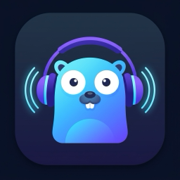

<p align="center">
  
</p>

<h1 align="center">Go-Dubber</h1>

<p align="center">
  A self-hosted <strong>Go + ReactJS</strong> AI media dubbing studio that probes your hardware, manages a live-mutable dubbing queue, synthesizes English &amp; Vietnamese AI voiceovers, and remuxes videos with dual-subtitle support — all shipped as a single binary.
</p>

---

## Features

- **Single-Binary Web App**: Go backend serves the embedded React + TypeScript + Tailwind SPA (`//go:embed`) with real-time **Server-Sent Events (SSE)** progress, logs, and notifications.
- **Auto Hardware Detection**: Probes host OS, CPU cores, and working FFmpeg encoders (`hevc_nvenc`, `hevc_videotoolbox`, `hevc_qsv`, `hevc_amf`, `hevc_vaapi`, or `libx265` CPU fallback) to select optimal encoding parameters automatically.
- **Smart Local vs. NAS Handling**:
  - Detects local SSD files (`syscall.Statfs`) to **skip downloading** and perform instant atomic swaps on the same volume.
  - Downloads NAS/SMB/NFS files once to local SSD (`./workdir`), verifies integrity, and safely replaces them back on the NAS with rollback protection.
- **Crash Recovery & Chunk Reuse**:
  - Persists queue state (`workdir/queue.json`) and per-job manifests (`workdir/jobs/<id>/state.json`).
  - Automatically detects unfinished work on startup so you never re-copy multi-GB NAS files or lose rendered TTS audio chunks.
  - Includes a **Reuse Chunks** toggle in the UI to reuse or discard cached `chunk_XXXX.wav` files before running.
- **Live-Mutable Queue & Lifecycle Controls**:
  - **Start / Pause / Stop** processing cleanly at any time.
  - Add files/folders (via Server File Browser or cross-platform **Quick Paste Path** supporting macOS Finder *"Copy as Pathname"* & Windows Explorer *"Copy as path"*), reorder, edit per-item configs, or remove/cancel items **while the queue is running**.
- **Dual-Subtitle Pipeline (TTS vs. Embedded ASS)**:
  - Separate **TTS Subtitle** (e.g., clean `.srt`) and **Embed Subtitle** (e.g., `.ass` preserving styles, signs, and descriptions in MKV containers).
  - **1-Click Extract Embedded Subtitles** (Download `.ass`/`.srt` or Copy to Clipboard for translating/cleaning with Gemini or other LLMs).
  - **Upload or Drag & Drop** external subtitles directly onto any queue item with language (`EN`/`VI`) and role (`TTS + Embed`, `TTS Only`, `Embed Only`) selection.
- **Audio Track Controls**:
  - Lists all embedded audio tracks per video, lets you select the **Source (Origin) Audio** track, supports **silent screen recordings** (0 audio tracks → TTS added as Track #0), leaves existing audio languages unchecked by default, and lets you **Add a new track** or **Replace a faulty track**.
- **Automatic TTS Health Monitor + In-Browser English Fallback**:
  - Continuously monitors the remote TTS backend (`GET /health`).
  - Includes an optional **In-Browser `kokoro-js` (WebGPU / WASM)** Web Worker so you can dub **English (`en`)** directly in your browser tab even when no remote TTS backend is running.

---

## Architecture

```text
ReactJS SPA (Embedded via go:embed)
    │  REST API + SSE (/api/events)
    ▼
Go Server (cmd/go-dubber)
    ├── Hardware Detector     → Probes NVENC / VideoToolbox / QSV / AMF / VAAPI / libx265
    ├── Queue Manager         → Live add/remove/reorder, Start/Pause/Stop, workdir/queue.json
    ├── Workspace & Recovery  → Persistent workdir/jobs/<id>/, local copy & chunk cache
    ├── Dual-Sub Resolver     → Separate TTS (.srt) vs Embed (.ass) + 1-click extraction
    ├── TTS Health Monitor    → Polls remote tts-service + In-Browser KokoroJS EN fallback
    └── FFmpeg 2-Pass Engine  → Audio mix/replace + GPU/CPU encode or stream copy
```

---

## Prerequisites

- **[Go](https://go.dev/)** 1.22+ (1.26+ recommended)
- **[Node.js](https://nodejs.org/)** 20+ (only needed when building the React UI from source)
- **[FFmpeg](https://ffmpeg.org/)** & `ffprobe` available in `PATH`
- **TTS Backend**: **[tts-service](https://github.com/safari3308/tts-service)** (recommended default backend supporting Vietnamese & English TTS + subtitle synchronization) — or any custom server implementing the [TTS Backend API Specification](#tts-backend-api-specification) below. *(For English-only offline dubbing, you can also enable **Browser EN (KokoroJS)** directly in the web UI header.)*

---

## Quick Start

### 1. Configure
```bash
cp config.example.json config.json
```
Edit `config.json` (or configure everything directly in the Web UI Settings modal):

| Field | Description |
| --- | --- |
| `nas_dir` | Default root directory for the server file browser |
| `work_dir` | Local SSD working directory for staging & recovery (default: `./workdir`) |
| `server_port` | HTTP port for the web app (default: `8080`) |
| `api_url` | Base URL of your TTS backend (e.g. `http://localhost:8000` for [tts-service](https://github.com/safari3308/tts-service)) |
| `api_token` | Bearer token sent in `Authorization: Bearer <token>` |
| `dub_languages` | Default target dubbing languages (`["en", "vi"]`) |
| `use_gpu` | Prefer GPU encoding when a working hardware encoder is detected |
| `auto_detect_hardware` | Auto-select optimal FFmpeg parameters for the current machine |
| `workers` | Concurrent TTS synthesis workers (default: `2`) |
| `reuse_audio_chunks` | Default state for the **Reuse Chunks** toggle (default: `true`) |

### 2. Build & Run
```bash
# Build React frontend + Go binary with embedded UI
make build-all

# Launch Web App at http://localhost:8080
./bin/go-dubber

# Optional flags
./bin/go-dubber --port 9090          # Custom port
./bin/go-dubber --config my.json     # Custom config file
./bin/go-dubber --dev                # Enable CORS for Vite dev server
./bin/go-dubber --cli                # Legacy headless CLI mode
```

### Development Mode (Hot Reload)
```bash
# Terminal 1: Go API backend with CORS
go run ./cmd/go-dubber --dev

# Terminal 2: Vite React dev server (proxies /api -> :8080)
cd web && npm install && npm run dev
```

---

## TTS Backend API Specification

The default backend is **[safari3308/tts-service](https://github.com/safari3308/tts-service)**. If you want to build your own compatible backend (e.g., wrapping Kokoro, Piper, F5-TTS, Edge-TTS, XTTS, or OpenAI TTS), implement the following HTTP endpoints:

### Authentication
All requests include:
```http
Authorization: Bearer <api_token>
```
*(Omitted on `/health` if `api_token` is empty.)*

---

### 1. Health Check (Required)
Polled every 10 seconds by Go-Dubber (3-second timeout).

- **Endpoint**: `GET /health`
- **Success Response**: `200 OK` (body ignored; e.g. `{"status": "ok"}`)

---

### 2. Single-Line TTS Synthesis (Required)
Synthesizes one dialogue subtitle line into WAV audio. Go-Dubber calls this concurrently across `workers` goroutines (30-second timeout per line, with 1 automatic retry).

- **Endpoint**: `POST /v1/audio/speech`
- **Headers**:
  - `Content-Type: application/json`
  - `Authorization: Bearer <api_token>`
- **Request Body**:
  ```json
  {
    "text": "Hello world!",
    "lang": "en",
    "role": "A",
    "speed": 1.1
  }
  ```
  | Field | Type | Description |
  | --- | --- | --- |
  | `text` | `string` | Cleaned dialogue line (for `vi`, numbers are pre-normalized to Vietnamese words) |
  | `lang` | `string` | Language code: `"en"` or `"vi"` |
  | `role` | `string` | Speaker/voice role identifier (currently `"A"`) |
  | `speed` | `float` | Playback speed multiplier (e.g. `1.0`, `1.1`, `1.25`) |

- **Success Response**: `200 OK`
  - **Body**: Raw WAV file bytes.
  - **Required Audio Format**:
    - Container: Standard RIFF/WAVE header containing a `data` chunk
    - Encoding: Uncompressed **16-bit signed little-endian PCM** (`pcm_s16le`)
    - Sample Rate: **24,000 Hz**
    - Channels: **1 (Mono)**
- **Error Response**: Any non-`200` status code with an error message in the response body.

---

### 3. Subtitle Timeline Synchronization (Optional)
Used when `skip_sub_sync` is `false` and an external subtitle is being synced against either an embedded subtitle or an extracted reference audio track (5-minute timeout). If your backend does not implement this, enable `skip_sub_sync: true` (or let Go-Dubber gracefully fall back to the original subtitle timing).

- **Endpoint**: `POST /v1/utils/subsync`
- **Headers**:
  - `Content-Type: multipart/form-data`
  - `Authorization: Bearer <api_token>`
- **Form Fields**:
  | Field | Type | Description |
  | --- | --- | --- |
  | `target_sub` | `file` | External `.srt` subtitle file to synchronize |
  | `reference_file` | `file` | Reference `.srt` (sub-to-sub sync) or 16 kHz mono `.aac` anchor audio (audio sync) |
  | `ref_type` | `string` | Reference mode (`"audio"`) |
- **Success Response**: `200 OK`
  - **Body**: Synchronized `.srt` subtitle text (UTF-8).

---

## License

[MIT](LICENSE)
